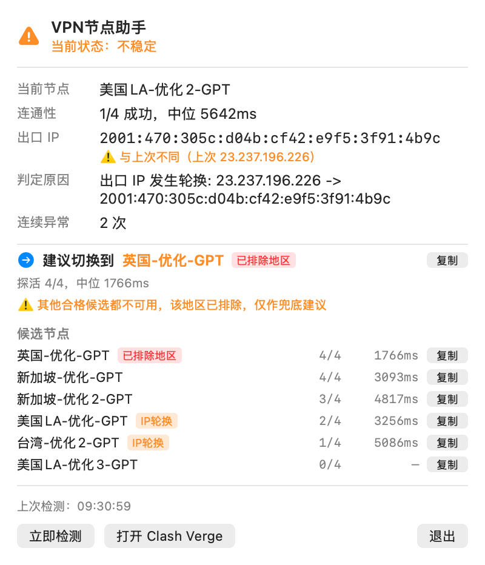

# VPN节点助手

macOS 菜单栏小工具：持续体检 Clash Verge 里的 ChatGPT 专线节点，节点不稳定时在菜单栏变色提醒，点开即可看到当前节点状态、判定原因，以及建议切换到的节点。

**它只做检测和建议，不会自动切换节点。**



---

## 它解决什么问题

如果你在用 Clash Verge 这类工具访问 ChatGPT，大概率遇到过这种情况：

- **GitHub、YouTube 一切正常，只有 ChatGPT 和 Codex 进不去**
- 节点列表里延迟显示是漂亮的绿色，点进去却一直转圈或循环人机验证
- 换了好几个节点都没用，因为**通用节点和 ChatGPT 走的根本不是同一个策略组**

这个工具就是盯着那个策略组的。核心发现是：**延迟低 ≠ 能用**。

真正决定 ChatGPT 能不能用的是**出口 IP 是否固定**。Cloudflare 的 `cf_clearance` 和 OpenAI 的凭证都绑定客户端 IP，如果一个节点每次连接都换出口 IP，验证就永远无法通过——哪怕它的延迟测试每次都能过。

实测数据（同一批节点）：

| 节点类型 | 延迟显示 | 出口 IP | 实际能否用 |
|---|---|---|---|
| 共享轮换节点 | 266ms 蓝色 | 6 次请求 6 个不同 IP | ❌ 验证死循环 |
| 固定出口节点 | 479ms 橙色 | 6 次请求同一个 IP | ✅ 正常 |

所以本工具**不拿延迟做判据**。

## 「不稳定」是怎么定义的

每次体检对当前节点做 4 次间隔 1 秒的探活（请求 `https://chatgpt.com/cdn-cgi/trace`），再采样一次出口 IP，然后按下面的顺序判定：

| 顺序 | 条件 | 判定 | 提醒时机 |
|---|---|---|---|
| 1 | 探活 0/4，且 **10 秒后复测仍为 0/4** | 🔴 故障 | 立即 |
| 2 | 探活成功率 < 3/4 | 🟠 不稳定 | 连续 2 次（约 1 小时） |
| 3 | 出口 IP 与上次不同 | 🟠 不稳定 | 连续 2 次（约 1 小时） |
| 4 | 以上都不成立 | 🟢 健康 | — |

几个刻意的设计：

- **0/4 不当场定性。** 这类中转节点延迟波动很大（实测 2~6 秒递增），一次拥塞可能让几秒内连续 4 次探测全部超时，半分钟后自己就恢复了。所以先等 10 秒复测一轮，两轮都是 0 才判故障。复测恢复的情况会记录在「判定原因」里，但不打扰你。
- **不健康要连续 2 次才提醒**，避免单次抖动误报。
- **出口 IP 只在节点没变时才比较。** 你自己手动换了节点，不算 IP 轮换。
- **提醒不会重复轰炸**：只在「问题刚开始」和「恶化为完全不通」时各提醒一次。

## 为什么不自动切换

因为**自动切换有账号风险，而检测没有**。

- **探活请求是未认证的**，不带任何 Cookie / Token，OpenAI 完全不知道是哪个账号发的——跑多频繁都无所谓。
- **切换会改变你登录会话的出口 IP**。频繁跨地区跳 IP 是 OpenAI 风控会关注的行为，真实后果通常是：验证变多 → 提示「异常活动」→ 强制重新登录 → 临时锁定，极端情况下才是封号。

所以本工具的定位是「告诉你坏了，并建议换哪个」，切换这一步交给你自己点。如果你确实想要自动切换，`engine/vpn-node-guard.sh` 保留了 `--switch` 模式（带 12 小时冷却 + 活跃会话保护 + 出口 IP 预校验三重刹车），但默认不启用。

## 安装

需要 macOS 13+ 和 Xcode Command Line Tools（`xcode-select --install`）。

```bash
git clone https://github.com/Universeeeeeee/VPN-Assitant.git
cd VPN-Assitant
./install.sh              # 安装引擎 + 构建 + 启动
./install.sh --login-item # 顺便加入登录项(开机自启)
```

建议同时安装 `jq`（`brew install jq`），脚本解析 JSON 会更可靠。

## 使用

菜单栏显示：

| 显示 | 含义 |
|---|---|
| 🛡 `节点正常` | 一切正常 |
| ⚠️ `节点不稳定` | 探活不达标，或出口 IP 变了 |
| ⛔ `节点故障` | 连续两轮探活全部失败 |
| 📵 `节点未开` | Clash Verge / mihomo 没运行 |

点击展开详情：当前节点、连通性、出口 IP（含是否变化）、判定原因、建议切换的节点、候选节点列表。

命令行直接调用检测引擎：

```bash
~/.local/bin/vpn-node-guard.sh            # 人类可读报告
~/.local/bin/vpn-node-guard.sh --status   # 逐个列出组内所有节点
~/.local/bin/vpn-node-guard.sh --json     # JSON 报告（App 消费的就是它）
~/.local/bin/vpn-node-guard.sh --dry-run  # 走一遍决策流程，不写任何配置
~/.local/bin/vpn-node-guard.sh --switch   # 评估并真正切换（默认不启用）
```

日志：

```bash
tail -f ~/Library/Logs/VPNNodeHelper.log                    # App 侧
tail -f ~/.local/state/chatgpt-node-guard/guard.log         # 引擎侧
```

## 配置项

全部通过环境变量覆盖（App 调用脚本时继承自身环境，改定时任务的参数需要改 `app/App.swift` 后重新构建）：

| 变量 | 默认 | 说明 |
|---|---|---|
| `CNG_GROUP` | `ChatGPT` | 要监控的策略组名 |
| `CNG_PROBE_URL` | `https://chatgpt.com/cdn-cgi/trace` | 探活目标 |
| `CNG_PROBES` | `4` | 每个节点探测次数 |
| `CNG_TIMEOUT_MS` | `10000` | 单次探测超时 |
| `CNG_PROBE_GAP_S` | `1` | 探测间隔；太小会推高节点延迟造成误判 |
| `CNG_HEALTHY_OK` | `3` | 达到几次成功算连通性达标 |
| `CNG_CONFIRM_RETRY` | `1` | 0/N 时是否先复测确认 |
| `CNG_CONFIRM_DELAY_S` | `10` | 复测前等待秒数 |
| `CNG_ALERT_STREAK` | `2` | 连续几次不健康才提醒 |
| `CNG_EXCLUDE_REGIONS` | `英国,香港` | **不建议切换到的地区**，按节点名前缀匹配 |

`CNG_EXCLUDE_REGIONS` 会同时影响候选排序和建议：被排除地区的节点排到最后并标注 `[已排除地区]`；只有当其他合格候选都不可用时才会兜底推荐，并明确警告。

想改检测间隔、菜单栏文案，改 `app/App.swift` 里的 `GuardModel.intervalMinutes` 和 `menuBarText`，然后重新构建。

## 界面预览

改完 UI 不用点菜单栏，直接离屏渲染一张 PNG 就能看：

```bash
./app/preview.sh /tmp/panel.png
```

## 项目结构

```
VPN-Assitant/
├── engine/
│   └── vpn-node-guard.sh     # 检测引擎：探活、出口 IP 采样、判定、JSON 输出
├── app/
│   ├── App.swift             # 菜单栏 App (SwiftUI MenuBarExtra)
│   ├── Preview.swift         # 离屏预览入口 (仅 -D DEMO 编译)
│   ├── Info.plist
│   ├── build.sh              # 构建 App bundle
│   └── preview.sh            # 渲染界面预览
├── docs/preview.png
└── install.sh
```

引擎和界面是分开的：`vpn-node-guard.sh` 可以单独用，App 只是给它套了个菜单栏界面。

## 已知限制

1. **候选节点的出口 IP 测不了。** 不切换就没法测别的节点出口 IP，所以候选排序只用探活成功率 + 延迟；只有你**曾经用过**的节点会被标注「IP轮换」（靠历史积累，用得越久越准）。
2. **mihomo 的 delay 接口偶发假失败**（返回 `An error occurred in the delay test`），靠探测间隔 + 复测确认 + 去抖动缓解，极端情况下仍可能多报一次。
3. **App 需要保持运行**，关掉就不再检测（可用 `--login-item` 让它开机自启）。
4. **治标不治本。** 这个工具能告诉你节点坏了、建议换哪个，但改变不了「共用机房 IP 会被风控」这件事。想彻底稳定，还是得换一个出口固定的独享落地。

## License

[MIT](LICENSE)
